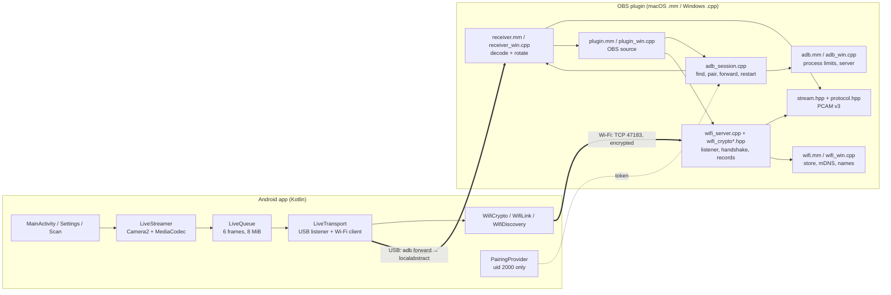
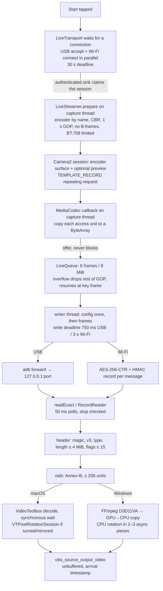
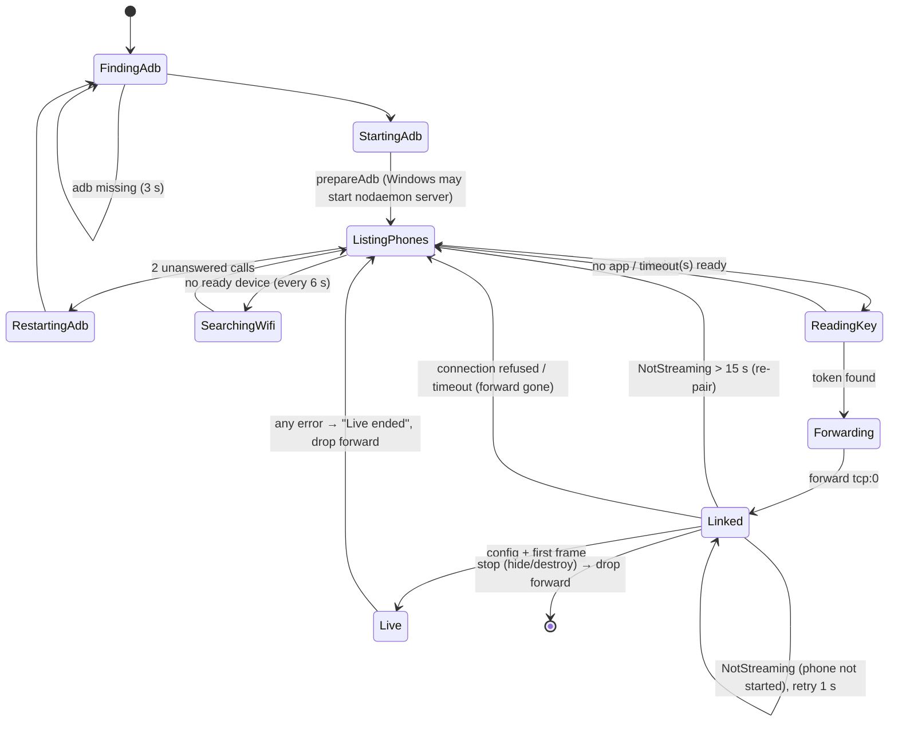
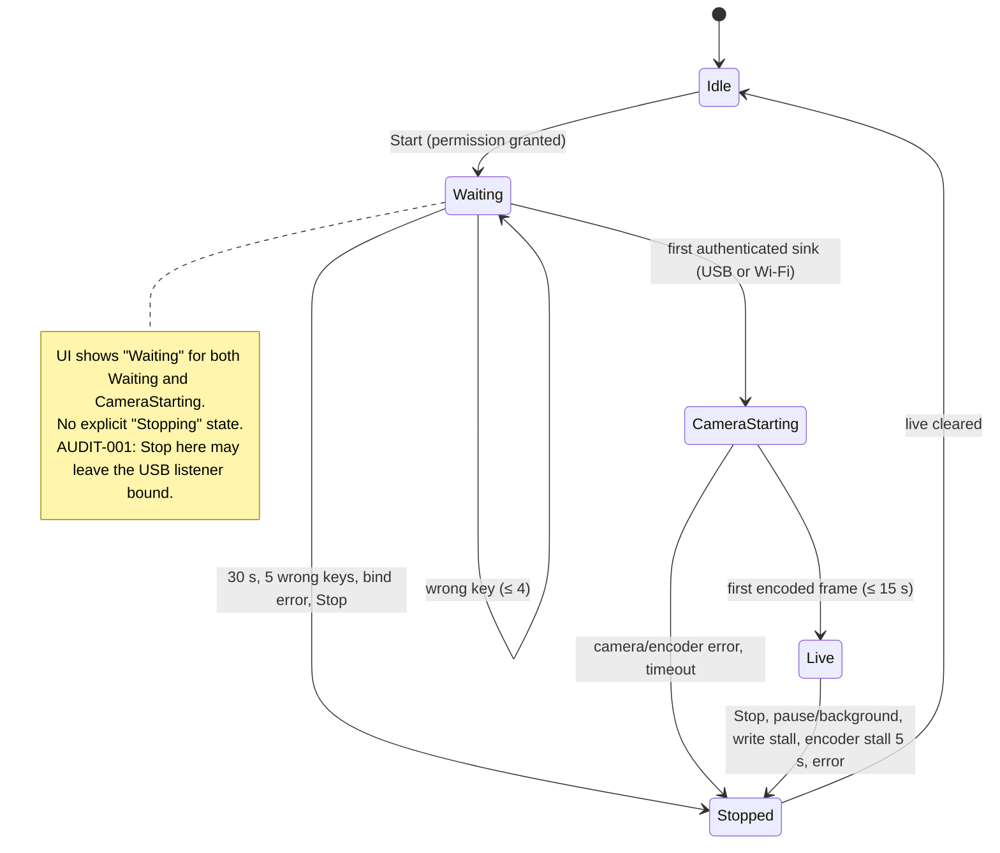
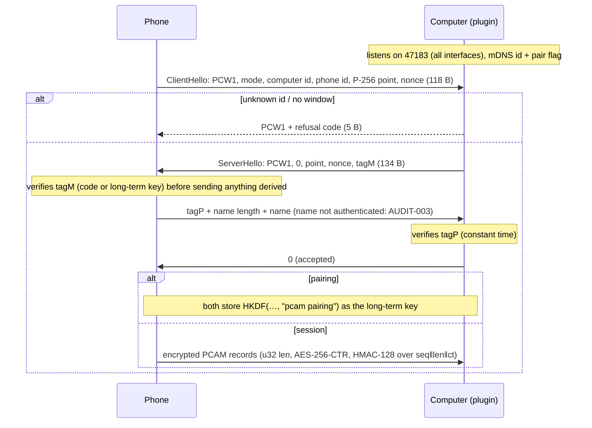

# Architecture review

Reconstructed from the code at `9f0b0cb`, not from the docs. Line references are in [FINDINGS.md](FINDINGS.md) and the reviewer notes summarised there.

## Components

## Video pipeline (as implemented)

**Thread boundaries:**

| Side | Thread | Owns |
|---|---|---|
| Phone | main | UI, camera state callback |
| Phone | `phonecam-live-capture` | Camera, codec, encode callbacks, release in `finish()` |
| Phone | `phonecam-usb-writer`, `phonecam-wifi-writer` | Socket I/O |
| Phone | watchdog executor | 250 ms deadline checks |
| Desktop | One worker per visible source | adb loop, receive, decode, rotate, output |
| Desktop | One Wi-Fi thread per visible source | Listen, handshake, decode |
| Desktop | OBS video thread | Calls `show` / `hide` / `video_tick` |
| Desktop | OBS UI thread | Calls `properties` / `update` |

**Buffering:**
- The phone queue holds 6 frames.
- The desktop holds no frame queue: one message is in memory at a time, and the OBS source is unbuffered.
- Socket and adb buffers sit in between and grow only under back-pressure (AUDIT-009).

**Clock domains:**
- Phone PTS is in microseconds and is forwarded unchanged; the desktop uses it only for ordering checks.
- OBS timestamps are taken at arrival (`os_gettime_ns`).
- No latency is inferred from encoder timestamps, which matches the project rule.

## Connection and session state

USB, desktop side (`adb_session.cpp`):

Phone side (`LiveStreamer` / `LiveTransport` / `MainActivity`):

Wi-Fi pairing and session (both ends):

## Ownership and lifetime analysis

| Resource | Owner | Released by | Assessment |
|---|---|---|---|
| Camera, session, codec, input surface | Phone capture thread | `LiveStreamer.finish()`, idempotent and ordered | Good; a late `onOpened` is closed |
| USB listener / accepted socket | USB writer thread | `LiveTransport.close()` | Close does not wake a blocked `accept`/`write` (AUDIT-001, 020a) |
| adb forward | Desktop worker | `dropForward()` on drop/exit | Good; one spawn per hide (AUDIT-002) |
| adb server (Windows) | Plugin job object | OBS exit / `restartAdb` | Good; start not bounded (AUDIT-010) |
| VT session, pixel buffers | `receiver.mm` objects | RAII / CFRelease on all paths | Good (verified, plus ASan run) |
| AVFrame/AVPacket/hw device | Windows `Decoder` | Destructor | Good |
| Worker thread vs `Source` | macOS: join; Windows: `Link` hand-off | `end()` | macOS unbounded (AUDIT-002); Windows safe but slow |
| Pairing store | File per OS user | Load/save per call, no lock | Race and wipe on read failure (AUDIT-021e) |

## Strengths

- **One wire format for USB and Wi-Fi.** Wi-Fi only wraps PCAM in records, so decoding, ordering and recovery are shared code (`stream.hpp`).
- **Strict validation.** Untrusted lengths are bounded before allocation, and configuration, dimensions, key flags and ordering are checked. Fuzzing confirmed it fails safely.
- **Fresh frames win under congestion.** The bounded phone queue drops whole groups of frames and resumes at a key frame, so old frames never pile up; the desktop holds no queue.
- **Portable crypto.** One handshake definition with three platform back-ends, cross-checked by shared test vectors and live interop tests (Kotlin ↔ Mac locally, Kotlin ↔ Windows in CI).
- **No dependency sprawl.** The phone uses only ZXing. The desktop uses only OS APIs plus OBS's own FFmpeg on Windows. All downloads are pinned and checksummed.
- **Honest gates.** Build and test output repeatedly states what is not physically proven.

## Weaknesses

1. **Lifecycle logic sits inside the OBS source.** Each source owns adb, forwarding, the Wi-Fi listener and decoding. This causes blocking on hide (AUDIT-002), multi-source conflicts (AUDIT-011) and two writers of one status line (AUDIT-022i). A module-level connection manager would separate "connection" from "display".
2. **Duplicated plugin code.** `plugin.mm` and `plugin_win.cpp` share about 70 identical lines and have already diverged: Windows has the `Link` hand-off and watchdog, macOS does not.
3. **USB authentication is one-way and sends the secret in clear**, while Wi-Fi has a full mutual handshake (AUDIT-007). Two security models for one product.
4. **Errors only travel one way.** The receiver cannot tell the phone why it closed (AUDIT-013).
5. **No shared schema for the wire format.** Header layout and limits are written separately in Kotlin (`LiveTransport.header`) and C++ (`protocol.hpp`). They agree today (checked field by field), but only the integration tests guard that.
6. **Platform files mix concerns.** `wifi.mm` / `wifi_win.cpp` hold storage, naming, addresses and mDNS together, with different locking.

## Cross-component contracts (checked field by field)

| Contract | Phone | Desktop | Agreement |
|---|---|---|---|
| Magic, version, type | `LiveTransport.kt:48-49` | `protocol.hpp:14-19` | Yes (v3, types 1/2) |
| Lengths | config ≤ 64 KiB, frame ≤ 4 MiB (`:155, 162`) | same (`:20-21`) | Yes |
| Flags | key, 2-bit turns, mirror (`:45`) | same (`receiver.mm:176`, `receiver_win.cpp:220`) | Yes |
| Byte order | big-endian `ByteBuffer` | `be32/be64` | Yes |
| Config payload | codec, w, h, rotation, Annex-B csd (`LiveStreamer.kt:141-145`) | same (`receiver.mm:118-123`) | Yes (no frame rate field, despite `ARCHITECTURE.md`) |
| Sequence / PTS | increasing; gap → drop to key frame | gap → wait for key frame | Yes |
| Token line | 64 hex + LF, 2 s, constant-time | sent first | Yes (one-way, AUDIT-007) |
| Wi-Fi handshake and records | `WifiCrypto.kt`, `WifiLink.kt` | `wifi_crypto.hpp`, `wifi_server.cpp` | Yes (shared vectors, interop tests); name outside the MAC |
| Error reporting | maps EPIPE to "OBS stopped receiving" | closes without a reason | One-way (AUDIT-013) |

**Recommendation:** add a small table-driven test that encodes headers from the Kotlin side and parses them with `protocol.hpp`, using the fixture generator, so the two definitions can't drift silently.

## Future compatibility (only what current design decisions obstruct)

| Future item | Obstacle in current design | Needed now? |
|---|---|---|
| Multiple sources / multi-camera | Per-source connection ownership; first phone always wins (AUDIT-011) | No; fix the conflict message now, build the manager later |
| Windows receiver (in progress) | Duplicated plugin code; GPU read-back cost (AUDIT-009) | Partly; see the roadmap |
| Audio | No reverse channel and arrival timestamps. A/V sync will need a shared clock mapping (already noted in `docs/PLAN.md`) | No |
| iPhone sender | Protocol is platform-neutral; USB depends on adb (no iOS equivalent) | No |
| Other transports | `stream.hpp`'s reader abstraction already supports them | No |
