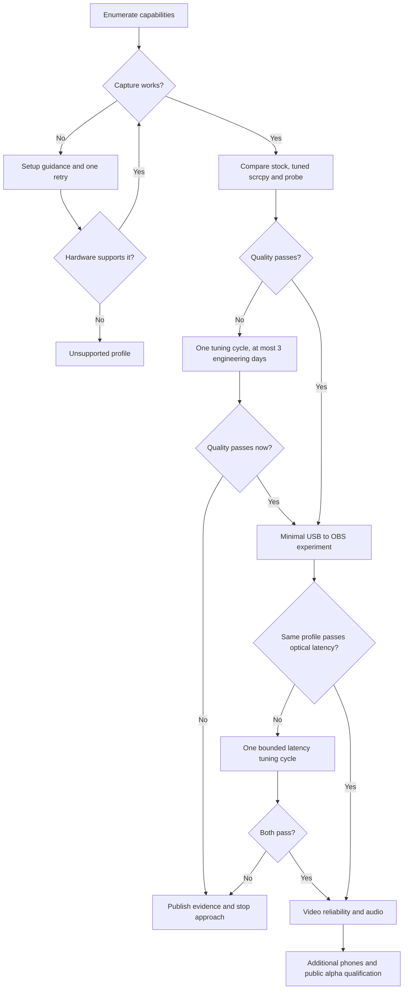

# Android phone camera to Mac and OBS

## Product and research boundaries

Separate repository; Android 10+ and Apple Silicon Mac first. ADB over USB is acceptable for research and the first personal version. Broad support means capability detection with verified, compatible-unverified, limited, and unsupported profiles; it does not mean every phone meets 4K30 or sub-100-ms latency.

The reference phone must approach stock **normal SDR rear-camera video** and reach optical latency p95 below 100 ms at the same profile before a full product commitment. Older phones may opt into limited modes. Stock HDR/beauty/night processing, iPhone, Windows/Linux, Wi-Fi, virtual camera, multiple phones, SwiftUI and installers are later investigations.

## Research sequencing exception — 6 November 2026

After confirming AVC/HEVC capture and applied HIGH_QUALITY processing, the user explicitly requested proceeding with USB/OBS research. Controlled stock/probe quality remains **inconclusive**. The decision map below remains the product qualification rule; this exception permits exploratory implementation without declaring any gate passed. See [USB live setup and limitations](USB_LIVE.md).

## Product direction — 7 November 2026

The user's goal: use their own phone as an OBS camera on their laptop, choosing rear/front camera and quality on the phone, applying masks/filters and recording in OBS (built-in OBS features; no plugin work). The phone is only the camera during live sessions; no on-phone copy. Requested, in order:

0. **Prove the existing USB path physically** (actual OBS image, stop/background/hide behaviour, short sustained run, front camera). Nothing below starts until this works.
1. **Phone features, wire format v2:** profile frame rate (30/60 where advertised, 4K included), dependent camera → resolution → fps → codec → bitrate selectors, phone live preview (fail clearly if the camera rejects preview + profile), any orientation locked at Start with Mac-side hardware rotation.
2. **Optional audio:** off by default; RECORD_AUDIO requested only when selected; 48 kHz PCM with phone-to-Mac clock mapping; 33 ms sync gate.
3. **Wireless via ADB Wireless debugging:** same pipeline; host pairing/connect helpers; measure against USB.
4. **Native Wi-Fi:** only if step 3 is insufficient and with separate approval (Internet permission, discovery, pairing, encryption).

Advertised profiles stay unverified until captured; this direction does not pass any gate. Versions, release scope and platform order (Windows required, phased) are in the [roadmap](ROADMAP.md).

## Phase gates

## Research implementation

Timebox initial camera work to ten engineering days excluding absent hardware and tool setup. Confirm the Vivo model/OS via ADB. Capture capabilities, supported recording sizes/ranges, processing modes and encoder constraints. Use Kotlin Camera2 and MediaCodec surface input, hardware H.264 baseline and H.265 comparison, no B-frames, and a one-second keyframe interval. No JNI or shared Rust core yet.

Test 4K30 when available; 1080p30 and explicit limited 720p30 diagnose limitations. Match lens, framing, frame rate, resolution, exposure conditions and color handling across stock video, direct-camera scrcpy, and the probe. Android's standard Camera Extensions are still/preview APIs, not an assumption of vendor video processing. HIGH_QUALITY settings can reduce frame rate; compare rather than enabling blindly.

Four scenes: well-lit detail, indoor face/skin tone, low-light movement, backlit subject. Winning profile repeats each scene three times. Blind rating must be at least 4/5 in every repeat, no persistent focus instability/severe artifacts/motion smearing, with actual encoded frame rate within 1% of 30 fps, at least 10 seconds of video, and no inter-frame gap above two target frame intervals. Four means close enough to use without corrective processing. Record requested vs observed camera metadata and encoder timing. A successful recording is not a quality pass.

## Conditional roadmap

1. **USB and OBS feasibility:** versioned framing with codec config, frame IDs, timestamps, keyframe markers, bounded parsing, ADB forwarding, VideoToolbox hardware decode and native OBS source. Measure optical latency with an external high-frame-rate camera; internal timestamps are diagnostic only. p95 <100 ms at the quality-approved profile.
2. **Reliability:** two-hour session, 20 unplug/replug cycles, bounded queues, cleanup and errors. Drop stale decoded frames; on encoded overflow recover at a valid keyframe. Verify source deletion, scene changes, lock/unlock, permission denial and malformed packets.
3. **Audio:** 48 kHz PCM initially, phone-to-Mac monotonic clock mapping and drift handling. Offset within 33 ms over one hour.
4. **Compatibility/onboarding:** test reference Vivo and at least two other manufacturers including one lower-end/older phone. Guide permissions, debugging, authorization and cable checks; unsupported hardware cannot be fixed through settings.
5. **Public alpha:** signed builds, documented dependencies, clean-Mac install without developer tools, uninstall, troubleshooting and CI. Re-estimate delivery after feasibility; do not promise the document's original calendar.

Only then consider control GUI, Wi-Fi, virtual camera and other platforms. Dual recording is separate and does not satisfy the live quality gate. Standard async OBS video uses RAM; zero-copy is a measured optimization, not a guarantee. Hardware encoding/decoding does not guarantee low heat.

## Primary references

- https://developer.android.com/media/camera/camera-extensions
- https://developer.android.com/reference/android/hardware/camera2/CaptureRequest
- https://developer.android.com/reference/android/media/MediaCodec
- https://github.com/Genymobile/scrcpy/blob/master/doc/camera.md
- https://docs.obsproject.com/reference-sources
